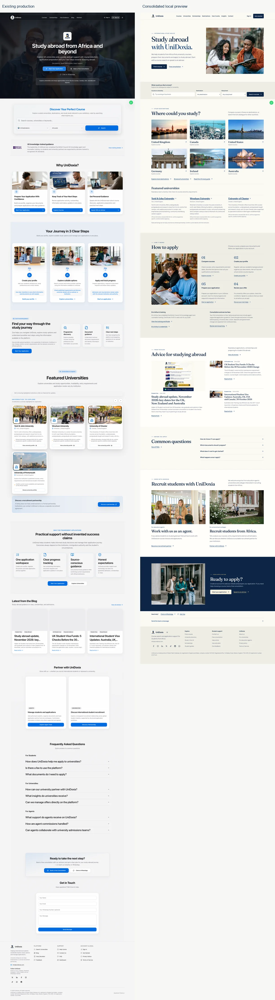

# UniDoxia landing-page consolidation audit — 7 November 2026

The comparison uses the actual running [production homepage](https://unidoxia.com/) and the built local preview at http://127.0.0.1:4192/. Work remains on `redesign/public-homepage` in [draft PR #1288](https://github.com/Otsikow/unidoxia/pull/1288). No production code, data, permissions or hosting was changed. The preview is local, not hosted staging.

## What the comparison established

Production still has useful capabilities that should survive the redesign: combined course/destination/level search, prominent consultation access, contextual university descriptions, direct profile/application entry links, role-specific FAQs and a homepage enquiry form. Its hero headline explains the service more literally. Its larger feature sections explain the application workspace in greater detail.

The local page already had real published articles, all seven social URLs from production, both partnership invitations, six equal destination photographs, an individually attributed credential link, light-default theme behaviour and the compact WhatsApp launcher. These were verified rather than recreated. An early capture made before the live queries settled showed loading states; the final captures explicitly wait for the published articles and real university records.

The [current ApplyBoard homepage](https://www.applyboard.com/) was inspected in the browser as a visual benchmark. Student photography, readable hierarchy and a clear first action informed the review. Its photographs, branding and layouts were not copied.

## Improvements completed and verified

| Requirement | Evidence in the consolidated page |
| --- | --- |
| Published blog and attractive images | Three real published articles, dates, categories, excerpts and decoded cover images. Actual article pages open. Loading, failure/retry and empty states are tested. |
| Official social accounts | All seven URLs from the production footer are preserved exactly: Facebook, Instagram, LinkedIn, X, TikTok, Reddit and WhatsApp channel. Accessible names and safe new-tab behaviour are retained. External verification limits are below. No YouTube URL was invented. |
| Education agents | A dedicated invitation with an education discussion photograph, factual supporting copy and the existing agent onboarding/registration journey. No commission rate or guaranteed benefit was added. |
| Universities | A separate invitation with a campus photograph and the existing recruitment enquiry/account process. It describes a potential relationship. |
| Authorised training badge | Original award artwork on Eric Arthur’s personal `/about/eric-arthur` page, linked from the homepage. The certificate and badge PDFs open. The supplied guidelines exclude general company homepages, so no organisation badge or accreditation claim was added. |
| WhatsApp | Original compact visible circles: 36px mobile, 40px desktop, 20px logo and a 44px hit target. Existing business number and analytics are retained. The contact link opens the WhatsApp landing page. |
| Photography and hero | The requested neatly dressed students remain in the hero. Library, professional education and campus scenes retain original faces/backgrounds and responsive AVIF/WebP delivery. All 14 final homepage images decoded in the settled captures. |
| International destinations | Six equally presented destinations remain. The introduction and full-catalogue action explain wider reach without promising availability. Combined search also exposes the existing configured destination choices. All six featured country searches returned matching public records. |
| Theme | First visits default to light even when the OS is dark. Explicit light, dark and system preferences survive reloads and apply before app startup. |
| Fees | The page explicitly separates the free first consultation, optional paid application support, and separate university, tuition, deposit and government charges. Current plan details remain on `/pricing`, rather than copying a price that could become stale. |
| Featured universities | Real summaries and source-check notes have been restored from the public university records. They use restrained editorial columns, genuine profile links and a clear statement that listings are not formal partnerships. |
| Optional Zoe | Its discreet entry point, sign-in explanation, opening/closing, Escape key and focus return remain. Authenticated answers are not claimed as verified. |
| Student journeys | Restored subject/destination/level search, scholarship navigation, first-screen free consultation and direct profile/application step links. The selected course survives the application → sign-in → registration handoff. |
| Responsive experience | Actual captures and image/overflow checks cover 320, 375, 390, 430, 768, 1024, 1440 and 1920px. The enquiry disclosure/form is inspected separately in desktop, tablet, mobile and saved-dark states. |

The homepage enquiry is restored as “Send the team a message”, using the existing contact component and endpoint. The disclosure keeps the page compact, loads the form on demand and preserves a draft across closing/reopening. Keyboard opening, error retention, retry and a simulated successful reset are verified. Email and a separate consultation path remain available.

Production’s additional Portsmouth exploration tile points to the general directory; there is no Portsmouth public profile in the generated catalogue. The local featured section uses the actual three returned records and does not reproduce the placeholder tile or display-position badges.

## Fresh visual evidence

[Mobile comparison](homepage-review/consolidation-mobile.webp) · [Tablet comparison](homepage-review/consolidation-tablet.webp)

Full-resolution production/local desktop, tablet and mobile PNGs, the eight final local viewport captures, open-enquiry screenshots, browser inventories and raw audit reports are in the local workspace `outputs/unidoxia-consolidation/` directory. Screenshots were captured from running pages, with fonts, public content and lazy images allowed to settle. Production was inspected read-only in a fresh anonymous browser context with write requests blocked.

In these browser captures, some production blog/partnership image elements had no decoded source image, and the Portsmouth logo did not load. The local page’s 14 images decoded. This describes the observed session and is not a claim that every production visitor experiences the same failure. The initial production mobile capture briefly measured 408px document width at a 390px viewport; its later settled capture fitted 390px. All eight settled local checks fitted their viewport.

## Verification results

- Full unit suite: **619 tests passed across 95 files**. A concurrent run had three five-second timeouts in existing admin/staff tests. The unchanged suite passed on its own in 13.77 seconds, without raising timeouts or weakening assertions. The timeout result and the standalone result are distinguished.
- Final complete desktop/mobile browser suite: **94 tests passed**. It includes combined search, filter changes/removal/empty/error states, native search handoff without JavaScript, actual university/article pages, direct consultation and scholarship routes, enquiry success/failure/retry, selected-course preservation through registration, profile/application entry links, theme preferences, WhatsApp, Zoe and anonymous route protection.
- Build and SEO/hosting-adapter checks passed for **1,536 public URLs**.
- Changed-file lint passed with **no errors or warnings**. TypeScript still reports the same three errors in unchanged `src/pages/student/Documents.test.tsx` at lines 43, 48 and 75. No new application type errors were reported.
- axe reported no WCAG A/AA violations in the sampled light homepage states at 320/1440px or the open enquiry states at 390/768/1440px light and 390px saved-dark. These scans are not a complete accessibility certification.
- Tests block production mutations. The course-filter suite now explicitly blocks analytics and other write requests while allowing named public search reads.

| Final Lighthouse lab audit | Performance | Accessibility | Best practices | SEO | LCP | CLS |
| --- | --- | --- | --- | --- | --- | --- |
| Desktop | 100 | 100 | 100 | 100 | 0.8 s | 0 |
| Mobile | 87 | 100 | 100 | 100 | 4.0 s | 0 |

The audits ran separately after browser and unit tests finished. Mobile total blocking time was 35ms. Mobile performance remains below the earlier 90 target, and simulated mobile LCP remains above 2.5 seconds. The existing application startup/static-to-React handoff remains a performance limit. These are local lab measurements, not field Core Web Vitals or evidence of improved conversion. Raw JSON reports are preserved beside the screenshots.

## External social verification

Each restored social link was actually opened from the page. Facebook resolved to “UniDoxia | Redcar”, Instagram resolved to the configured `@unidoxia` profile, and the WhatsApp channel displayed “UniDoxia.com” and its education description. TikTok’s configured profile URL loaded, but the latest browser run did not expose readable profile content. LinkedIn returned Cloudflare protection, X returned HTTP 403, and Reddit returned a security challenge. The configured URLs match production; independent current profile identity is not claimed for blocked/unreadable destinations.

## Remaining issues and untested functionality

1. **Authenticated application completion remains untested end to end.** Public course selection, authentication handoff and registration entry were checked; signup completion used an intercepted account response. Email verification delivery, signed-in profile/document upload, draft persistence, actual application submission and staff review were not executed against a real backend.
2. **Real enquiry persistence/delivery remains untested.** Contact and consultation success/error responses were intercepted. No real lead, task, email, WhatsApp message or appointment was created. University enquiries remain account-gated; authenticated partner submissions were not performed.
3. **Private workflows and payments were preserved, not live-account certified.** No auth policy, privileged-role logic, agent commission logic, student billing, database permission or admin/university workflow was modified. Paid checkout and provider transactions were not attempted. Existing agent onboarding/earnings claims were not validated against commercial agreements.
4. **Cross-browser and assistive-technology coverage is limited.** Browser acceptance uses Chrome desktop and mobile emulation. Physical devices, Safari/Firefox, screen readers and non-English localisation were not independently tested. Visa-calculator navigation was checked; current immigration calculation rules were not revalidated.
5. **The three existing TypeScript errors and external social verification limits remain.** They are not hidden by the successful Vite build or by valid-looking URLs.

## Where the previous production design is still stronger

- **Immediate literal explanation.** “Study abroad from Africa and beyond” communicates the service in the headline itself. The local “Your ambition, beyond borders” is more distinctive, but relies on its nearby international-study message and Africa-focused introduction for the full explanation.
- **Always-visible enquiry fields.** Production exposes its form without opening a disclosure. The local version preserves the form behind one explicit action to reduce page density. This is a deliberate convenience/space trade-off for Eric to review.
- **Role-specific FAQ breadth on the homepage.** Production shows student, agent and university questions directly. The local homepage prioritises four student questions and links to the complete FAQ route, retaining the content with one additional navigation step.
- **First-screen resource/control access.** Production exposes Visa Guidance and its theme toggle in the header. The local page keeps visa-calculator and theme access in the organised footer. Scholarship navigation and direct consultation access have been restored higher up.

These remaining differences are not presented as missing backend features. The consolidation restores the useful functions while retaining the approved quieter visual direction. Design approval, authenticated staging acceptance and production publication remain separate gates. Nothing in this report authorises a merge or deployment.
