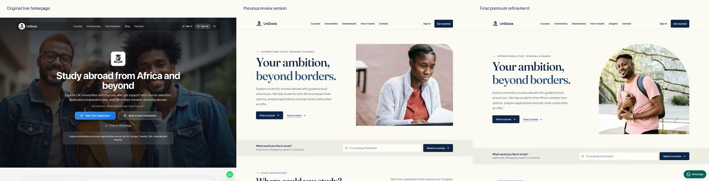
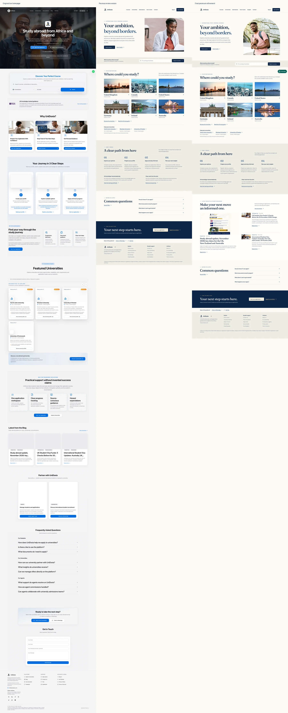

# UniDoxia homepage design review — 7 November 2026

Historical review of the preceding iteration. See [the subsequent photography and partnership review](HOMEPAGE-PHOTOGRAPHY-REVIEW.md) for the current design and verification evidence.

This is a design review deliverable on `redesign/public-homepage`, draft PR [#1288](https://github.com/Otsikow/unidoxia/pull/1288). Nothing has been merged, published or written to the production database. The working built preview is at http://127.0.0.1:4192/ on Eric's Mac. This is a local preview, not a hosted staging deployment.

## Visual decisions

The original live homepage, the previous review iteration, the actual new page and the current [ApplyBoard homepage](https://www.applyboard.com/) were inspected as rendered screenshots. ApplyBoard informed the emphasis on student photography, readable navigation and a clear primary action. Its visual identity and layouts were not reproduced.

The previous iteration's balanced six-country grid, quieter typography, four-step journey and restrained palette are retained. The original page's useful resource discovery and immediate contact access are restored through a real published Insights section and a visible WhatsApp button. The image now gives the hero a stronger human focal point while retaining the campus setting.

## Final page and behaviour

- Navigation and hero retain course discovery as the primary action. Registration and consultation remain separate, established paths.
- The hero uses an authentic licensed [RDNE Stock project campus photograph](https://www.pexels.com/photo/a-college-student-holding-a-book-and-smiling-7683693/), with responsive AVIF and WebP files. A transparent-background experiment was rejected because it softened the original detail. No generated person is used. See [asset credits](../public/home/ASSET-CREDITS.md).
- The six equal destination photographs link to the existing country-filtered catalogue. Genuine featured university records retain profile links and the existing distinction between a listing and a formal partnership.
- Four application steps, Eric Arthur's verified personal training certificate and service-pricing links retain their factual wording.
- Latest Insights reads published blog records, respects existing editorial exclusions, avoids repeated titles/covers, and displays dates, categories, excerpts and article links. It has loading, timeout, failure/retry and empty states. The generated initial HTML also contains the real article snapshot.
- Homepage cover derivatives compress the existing published images from roughly 4 MB to about 170 KB combined. Newly published covers still use their actual stored URL automatically. No article content or database record was changed.
- Light is the default on first visit. Saved light, dark and system preferences are honoured, including before the app downloads.
- A labelled WhatsApp button remains visible on desktop and mobile and opens the configured business number. Keyboard scroll spacing protects focused controls. Zoe remains a separate optional entry point, with clearer labels and an explanation of the existing sign-in requirement.
- FAQs, the application/consultation call to action and the compact legal/contact footer remain present.

## Verification

| Check | Result |
| --- | --- |
| Full unit suite | 619 tests passed across 95 files |
| Desktop/mobile browser acceptance | 60 tests passed |
| Build and static SEO verification | Passed, 1,535 public sitemap URLs |
| Changed-file lint | No errors, one pre-existing `transcribeBlob` dependency warning in `AIChatbot.tsx` |
| TypeScript | Three pre-existing errors in unchanged `src/pages/student/Documents.test.tsx`, lines 43, 48 and 75; no new errors |
| Viewport fit and visual capture | 320, 375, 390, 430, 768, 1024, 1440 and 1920 px; no horizontal overflow |
| axe accessibility | No reported WCAG A/AA violations at 320/1440 light and 390 saved-dark |
| Lighthouse desktop | Performance 100, accessibility 100, best practices 100, SEO 100; LCP 0.8 s, CLS 0 |
| Lighthouse mobile | Performance 89, accessibility 100, best practices 100, SEO 100; LCP 3.8 s, CLS 0 |

Browser checks exercised navigation, native search without JavaScript, keyword/country handoff, actual read-only catalogue results in all six countries, university profile links, articles, the external WhatsApp landing page, theme persistence, mobile navigation, keyboard controls, Zoe opening/closing and focus return, the certificate PDF, and protected anonymous-route redirects. Simulated unavailable country results explain the state and offer a tested reset. Published article failure/retry and empty responses were tested separately.

Registration was exercised through verification using an intercepted account response. Consultation/contact submissions, validation and retries used intercepted responses. These checks made no real student accounts, admissions submissions, leads or outbound messages. They do not prove production email delivery, authenticated Zoe answers, authenticated student/admin/agent workflows or database permissions end to end. Those systems and permissions were not modified by this pass.

Full desktop, tablet and mobile screenshots, the eight-width final captures, benchmark captures and raw Lighthouse reports are in the local workspace `outputs/unidoxia-final-premium/` folder. Original live-page captures remain in `outputs/unidoxia-landing-redesign/`.

## Remaining review limits

Mobile lab performance remains below 90 and LCP remains above 2.5 seconds. The audit identifies the final hero as the LCP element after the existing application startup. Initial static content appears earlier, but that does not satisfy the final LCP target. A broader application-startup optimisation has not been represented as completed. Lab results are not field Core Web Vitals or evidence of increased conversion.

The local preview and draft PR are ready for design review. A hosted branch preview has not been created. Do not use the existing Lovable main-branch preview as evidence of these unmerged changes. Production publication still requires Eric's approval and the established GitHub-to-Lovable release checks.
