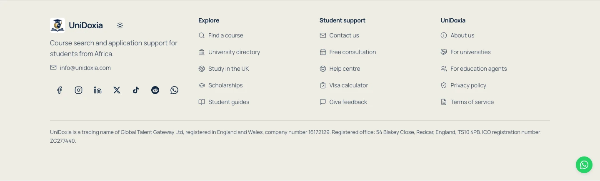

# UniDoxia final build and landing-page review

Reviewed on 7 November 2026. This is the latest review record for [PR #1288](https://github.com/Otsikow/unidoxia/pull/1288), superseding the earlier consolidation and photography reports for current verification results. Changes remain on `redesign/public-homepage`; no production deployment, database migration or permission change was made.

## Running environment

- Repository: `unidoxia-landing-redesign` in Eric's Codex workspace, remote `Otsikow/unidoxia`.
- Initial verified commit: `1073a833b83a83192244ce8826e15f80b26a9aa2`. The checkout was clean before this pass.
- Listener: Node PID **87273**, parent 87243, started 6 November at 23:14:47. Its working directory is this checkout. Its command is `vite preview --host 127.0.0.1 --port 4192 --strictPort`.
- Actual preview: **http://127.0.0.1:4192/**. This serves the built `dist` files. It is a local build preview, not a development server with automatic page updates or a hosted staging deployment.
- Before edits, the served HTML and `dist/index.html` had the same SHA-256: `f2dec343ed2dd5a9d6f1e13f74573a3d0a8dcd9a38598cf0d5a8783e5764f502`. The response was HTTP 200 with `Cache-Control: no-cache`.
- Both existing Brave and Codex in-app preview tabs displayed the latest plain headline, blog, university descriptions, partnership invitations and seven social links. The in-app tab retained a saved dark preference. That difference was not an old build or a failure of the first-visit light default.
- The preview process was left running. No browser storage, saved theme or unrelated work was discarded. Fresh test contexts had no registered service worker or Cache Storage entries.

The build now writes [build-info.json](http://127.0.0.1:4192/build-info.json) after all build checks succeed. It records the Git commit, branch, whether the checkout was dirty, build time and the generated homepage hash. No credentials, local filesystem paths or user data are included. This distinguishes a clean committed build from an intermediate build made while edits are still uncommitted. The final delivery reads back this record and checks its HTML hash against the response from port 4192.

An open preview tab needs a reload after a new build. The server itself does not need restarting when its `dist` files are replaced. The unmerged local design should not be confused with Lovable's main-branch preview or the public website.

## Requirements checklist

| Requirement | Result |
| --- | --- |
| Latest blog | Present and verified: three actual published articles with images, dates, titles and excerpts. Article pages and the blog index open. Loading, failure/retry and empty states are covered by browser checks. |
| Official social links | All seven configured production URLs are retained. Facebook, Instagram and the WhatsApp channel returned the expected identity signals. LinkedIn, X, Reddit and TikTok identities were additionally verified in the normal browser, resolving the headless inspection limits. Details are below. |
| Agent invitation | Dedicated photograph, audience label and invitation leading to existing agent onboarding and registration. No commission promise was added. |
| University invitation | Separate campus photograph and recruitment invitation leading to the existing partnership explanation and account-gated enquiry. It describes a possible relationship. |
| British Council credential | Original awarded badge remains on Eric Arthur's personal `/about/eric-arthur` page, linked from the homepage. The supplied badge guidelines exclude a general company homepage placement. Original award and certificate PDFs open. The badge is not presented as company accreditation. |
| WhatsApp | Compact 36px visible mobile circle, 40px desktop circle, 20px symbol and 44px hit target. Correct business contact opens; it remains clear of focused controls in browser checks. No WhatsApp message was sent. |
| International destinations | Six equal destination photographs and working country filters remain. The homepage now offers an explicit adviser link for other countries. All nine configured country choices were checked against the live public validation/search path; three need the availability explanation described below. |
| Authentic photography | Original licensed Pexels student/campus photographs remain, with responsive AVIF/WebP delivery and documented sources. No generated human portrait was introduced. All 14 main-content images decoded at every requested width. |
| First-visit light mode | Verified with a dark OS preference and fresh storage. Explicit dark, light and system choices continue to work and survive reloads. |
| Clear hero and four steps | Plain “Study abroad with UniDoxia” messaging, the Africa-focused introduction, combined search and the four-step application journey are preserved. No em dashes were found in the rendered homepage text. |
| Footer icons and usability | Added consistent 16px line icons alongside all 15 navigation links and the email link. Text labels, official social marks and business/legal details remain. Mobile link rows have at least 44px height. The tablet brand wrapping found during visual review is fixed. |
| Student application system | Existing routes and authentication behaviour are retained. Selected courses and intended profile/application destinations survive the public registration handoff. Real signed-in submission remains an acceptance limit, not a claimed success. |

No requested landing-page section was found absent in the final rendered page. Badge placement is deliberately conditional on the supplied permission. A visible section and an accessible form do not by themselves prove backend delivery or authenticated application completion.

## Additional-country availability fix

The deeper check found a real existing problem: the site offers Spain, Malta and the United Arab Emirates as choices, but the live public validator cannot find an active university for those destinations and rejects the country. It consequently does not run the programme search. The previous UI told students to select a supported country even though they had chosen one from its own list.

The UI now explains “No course listings for [country] yet”, keeps the selected filter visible and offers an adviser link. The server validation remains in place. Unknown country values and other invalid filters still show their validation errors. No university, course, migration or permission was invented or added to make a search appear successful.

Real read-only checks returned country-matching courses for the UK, Canada, USA, Germany, Ireland and Australia. Spain, Malta and the UAE each displayed the new availability state and working adviser link. Returned row counts in the raw log are page sizes, not catalogue totals. Two regression cases, run on desktop and mobile, cover the offered-but-unavailable country and the unknown-country validation boundary.

## Visual evidence and production comparison

Fresh full-page local PNGs cover **390, 768, 1440 and 1920px**. Additional saved-dark captures cover 390 and 1440px. Each requested light layout has no horizontal overflow, no page errors, all 14 images decoded and no sampled axe WCAG A/AA violations. Saved-dark axe checks also passed at 390/1440px. The final tablet footer uses a full-width brand row and three navigation columns; desktop retains four columns. The complete footer and icons are also present in the initial HTML with JavaScript disabled.

[Fresh desktop production/local comparison](homepage-review/final-build-desktop.webp) · [Fresh mobile production/local comparison](homepage-review/final-build-mobile.webp)

Full-resolution screenshots, DOM/link inventories, raw Lighthouse reports, environment evidence and logs are in the local workspace `outputs/unidoxia-final-build/` folder. Captures came from running applications after fonts, articles, university records and lazy images settled. Production was inspected read-only with write requests blocked.

The local design keeps the production page's useful discovery, consultation, article, partnership, profile and application entry points. It gives the six destinations equal visual weight and replaces repeated feature blocks with a shorter photographic narrative. University listings use actual public records and explicitly avoid implying formal partnerships. Production's Portsmouth exploration tile still points to the directory rather than a real Portsmouth profile; that placeholder was not copied.

Production remains stronger in two convenience details: its enquiry fields are visible immediately, and its homepage has broader role-specific FAQs. The reviewed version retains the enquiry form behind “Send the team a message” and links its four student FAQs to the complete FAQ page. Production also places theme and visa guidance access in the header; the local version keeps theme and visa-calculator access in the footer. The former literal-headline weakness is resolved by the plain study-abroad headline and Africa-focused introduction.

Some production images did not decode in these particular captures: ten on mobile and seven on desktop. Both settled production captures fitted their viewport. These are observations from this session, not a claim that every production visitor sees missing images. No unsupported conversion or lead-generation improvement is claimed.

## Functional and automated verification

- **619 unit tests passed across 95 files**, run separately from browser/performance work.
- **98 desktop/mobile browser checks passed**. They cover discovery, country filters, removal/reset, empty/error states, initial HTML search without JavaScript, article and university routes, registration handoffs, consultation/contact forms, partnerships, social-link configuration, WhatsApp, optional Zoe, keyboard interaction, theme persistence and anonymous route protection.
- Production build passed, including SEO/hosting-adapter checks for **1,536 public URLs**. The optional adapter was tested locally, not deployed.
- Changed-file lint passed without errors or warnings. `tsc --noEmit -p tsconfig.app.json` reports the same three pre-existing `exact` option errors in unchanged `src/pages/student/Documents.test.tsx` at lines 43, 48 and 75. The root solution's empty-project type command is not treated as application type verification.
- Actual running-page checks verified all 15 footer navigation icons, labelled social links, mobile tap heights and the no-JavaScript footer. The tablet-only CSS correction was followed by fresh four-viewport captures and accessibility scans.
- Browser acceptance and screenshot scripts block writes. Forms use intercepted success/error responses; no real lead, booking, student account or application was created by these tests.

| Independent Lighthouse lab audit | Performance | Accessibility | Best practices | SEO | LCP | CLS |
| --- | --- | --- | --- | --- | --- | --- |
| Desktop | 100 | 100 | 100 | 100 | 0.8s | 0 |
| Mobile | 86 | 100 | 100 | 100 | 4.1s | 0 |

The audits ran independently after the browser/visual work, with analytics writes blocked. Mobile total blocking time was about 114ms. Mobile performance remains below 90 and simulated LCP remains above 2.5 seconds. The application startup and static-to-React handoff remain a performance limitation. These local lab scores are not field Core Web Vitals or proof of conversion gains.

## Social destination verification

The seven footer links were opened from the actual homepage. Normal browser inspection was used where automated headless requests were blocked or unreadable:

| Platform | Identity observed |
| --- | --- |
| Facebook | Configured profile ID `61584297605909` resolved to “UniDoxia | Redcar”. |
| Instagram | Configured `@unidoxia` profile resolved with its Instagram profile title. |
| LinkedIn | Company ID `110137778` resolved to the existing authenticated company dashboard, headed “UniDoxia” with its logo. No inbox, editor or settings were opened. |
| X | `@unidoxia` displayed “Unidoxia.com” and its `unidoxia.com` website reference. |
| TikTok | `@unidoxia.com1` displayed “unidoxia.com”, the matching handle and its study-abroad description with the business website. |
| Reddit | `r/UniDoxia` displayed the named community and registration status referring visitors to `unidoxia.com`. |
| WhatsApp channel | Channel `0029Vawx2lA2kNFjQrxOc640` displayed “UniDoxia.com” and its education description. |

No social post, reaction, follow or message was sent. The temporary verification tab was closed. No unverified YouTube URL was added.

## Remaining acceptance limits

1. Real email verification delivery, signed-in student profiles/document upload, saved application drafts, final submission and staff review were not executed against an isolated backend. Public handoffs are verified; real authenticated completion is not.
2. Contact/consultation persistence and outbound delivery were simulated. Authenticated agent/university submissions, Zoe answers, paid checkout and provider transactions remain untested. Existing private workflows and database permissions were not modified.
3. Spain, Malta and the UAE currently have no accepted public catalogue destination. Their clear availability state is verified; future live courses must be added and checked through the normal catalogue workflow before availability is advertised.
4. Mobile startup performance and the three baseline application type-check errors remain. Physical-device testing, Safari/Firefox, screen readers and non-English localisation were not independently completed. Immigration calculation accuracy was not part of this design audit.
5. The working preview is local. It does not establish a hosted branch deployment or a production release. The PR is for review, and production publication still requires approval.
