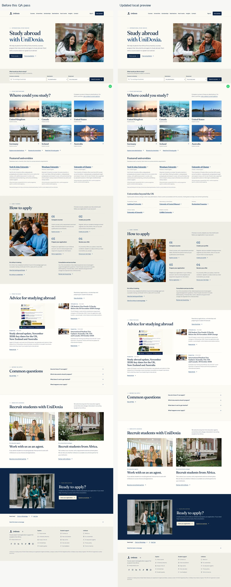
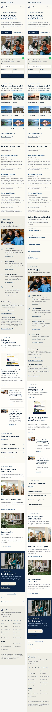
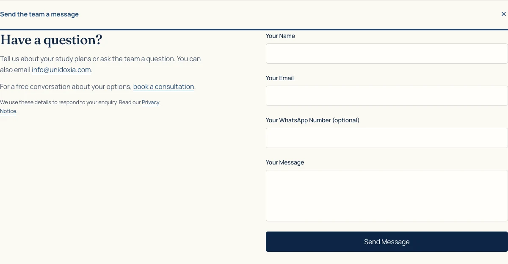

# UniDoxia final homepage quality review

**Latest supplied-reference refinement:** Restored the exact original logo, paragraph and single `/about` training-details action at Eric’s explicit request. See [training-strip follow-up](HOMEPAGE-TRAINING-STRIP.md).

**Earlier refinement:** [Restored prominent British Council training strip](HOMEPAGE-TRAINING-STRIP.md), with the old heading and placement below course search. The personal badge and direct certificate access remain.

Reviewed on 7 November 2026 for [PR #1288](https://github.com/Otsikow/unidoxia/pull/1288), branch `redesign/public-homepage`. This report supersedes the earlier build audit for the checks and changes below. The local preview is http://127.0.0.1:4192/. No production code, catalogue records, database permissions or deployment was changed. One explicitly approved live contact-form test was submitted.

## Completed and verified

| Requirement | Evidence and result |
| --- | --- |
| Preserve the design | Kept the student photography, six equally presented destination photographs, four steps, real published articles, separate agent/university invitations, fee explanation, compact WhatsApp, optional Zoe, footer icons and saved theme controls. Fresh visitors default to light even when their operating system prefers dark. |
| Align destination options | Consultation and student-intake preferences now share the nine named discovery destinations plus the existing New Zealand enquiry choice. Germany, Spain, Malta and UAE no longer disappear from these enquiry forms. Other / Not sure yet remain available for consultations. An enquiry choice does not promise an active catalogue. |
| Broader university geography | Kept all three existing UK featured placements. Added a separate restrained directory section for five existing active records: Lakehead University, University of Central Missouri, Hochschule Fresenius, University of Limerick and Griffith University. Eligibility requires verified/admin_verified status, matching country, an official HTTPS source and a recorded source-check date. Empty results hide the section; errors offer retry and the directory. The same links appear without JavaScript. |
| Honest university descriptions | No new partnership, endorsement, programme availability or application-readiness claim. These five institution identities have recorded checks dated 12 August 2026; their profiles remain marked `needs_review`. Official institution websites were opened during this review. Current course and intake details require checking. The three existing featured source notes now also render in initial HTML. |
| Contact usability and reliability | Added persistent field labels and appropriate autocomplete, larger mobile input targets, a synchronous duplicate-submit guard and explicit `success: true` handling. Errors preserve the draft. A 200 response containing `success: false` cannot produce a success message or clear the form. No automatic retry was added. |
| Actual contact submission | Exactly one approved test, reference `UDX-HOME-QA-20261107`, was submitted through the running homepage at 10:25:22 UTC. The live endpoint returned HTTP 200 with `{"success":true}`; the page showed its success notification and cleared the fields. The unchanged handler awaits the two provider sends before returning success. This establishes backend acceptance, not independently verified inbox delivery. |
| Personal British Council credential | The authentic awarded badge remains on Eric Arthur's personal profile, reached by the homepage “View training details” link in the restored training strip. It is not company accreditation. The supplied 2026 guidelines, page 3, exclude main website pages that are not about the awarded individual. The original asset hash is unchanged; the 500px asset displays at 240px on mobile / 216px on desktop. Award and certificate PDFs both returned HTTP 200 and PDF content. Their distinct validity dates remain accurately presented. |
| Photography provenance | Compared all five principal student/campus crops against their credited Pexels original downloads. Subjects and backgrounds match; the website uses cropped/compressed originals. No generated human photograph was introduced. All 14 homepage content images decoded at every requested width. The inherited published blog covers remain in place, but their original photographer/licence records were not established in this checkout. |
| Responsive quality | Full-page captures at 390, 768 and 1440px, plus saved-dark captures at 390/1440px. No horizontal overflow, page errors or rendered em dashes. All 15 footer navigation links retain line icons; mobile rows have at least 44px targets. Separate open-enquiry and personal-badge screenshots were inspected. |

## Functional evidence and boundaries

- **106 desktop/mobile browser checks passed**, covering course discovery and destination filtering; error, empty and retry states; blog and institution navigation; course-to-registration destination preservation; consultation/intake choices; agent and university partnership entry routes; WhatsApp; Zoe's anonymous prompt; keyboard access; theme persistence; initial HTML and contact-form behaviour.
- **622 unit tests passed across 96 files.** New eligibility checks reject inactive, archived, unverified, mismatched-country and invalid-source institutions without mutating records.
- Production build and SEO/hosting checks passed for **1,536 public URLs**. The hosting adapter was tested locally, not deployed.
- Changed-file lint passed without warnings. Application type checking still reports the same three pre-existing `exact` option errors in unchanged `src/pages/student/Documents.test.tsx`, lines 43, 48 and 75.
- Axe WCAG A/AA scans found zero violations in the three requested light layouts, both saved-dark layouts and the open contact form at 390/768/1440px light plus 390px dark. Automated scans do not establish complete accessibility conformance.
- Live read-only search returned matching-country programmes for UK, Canada, USA, Germany, Ireland and Australia. Spain, Malta and UAE currently fail the backend availability validator; the preserved UI explains that listings are unavailable and offers adviser help. Returned row counts are page sizes, not catalogue totals. No courses were invented.
- Registration success/error behaviour, consultation submission, intake submission and partner registration are tested with intercepted responses. No new real student account, lead, booking, partner submission or application was created. Signed-in document uploads, final applications, administrative review, agent/university dashboards and authenticated Zoe answers remain outside this acceptance evidence.
- The seven official social destinations and compact WhatsApp link were retained and route checks passed. Earlier normal-browser identity checks are recorded in the linked build audit. No WhatsApp or social message was sent.
- Outlook reached the authorised UniDoxia inbox, but its exact-reference search did not complete reliably before the app stopped responding. Recipient receipt, spam placement and the two individual delivered messages therefore remain unverified. No second test or unrelated-mailbox search was performed.

## Visual review and comparison

The new captures preserve the previous iteration's stronger hero, authentic photography, balanced destination grid, editorial journey, invitations and compact footer. The added international directory uses flat typography and rules rather than another set of image cards. The tablet has two columns, desktop three and mobile one. Persistent contact labels remain legible after typing and the compact WhatsApp does not cover the enquiry controls.

The prior [production comparison and screenshots](HOMEPAGE-FINAL-BUILD-AUDIT.md#visual-evidence-and-production-comparison) remain relevant: production exposes the enquiry fields immediately and offers broader role-specific homepage FAQs. This design keeps its enquiry behind “Send the team a message” and links the shorter homepage FAQs to the full FAQ page. Theme and visa-calculator controls remain in the footer. Those convenience differences are not presented as proven conversion gains.

Full-resolution screenshots, source-photo comparisons, public source records, country checks, the single approved contact response, axe inventories and raw test/performance logs are preserved locally in `../outputs/unidoxia-final-qa/` relative to the repository. `local-390.png`, `local-768.png` and `local-1440.png` are captured from the actual running preview, not design mockups.

## Remaining limitations and performance

| Independent local Lighthouse run | Performance | Accessibility | Best practices | SEO | LCP | TBT | CLS |
| --- | --- | --- | --- | --- | --- | --- | --- |
| Desktop | 100 | 100 | 100 | 100 | 0.76s | 0ms | 0 |
| Mobile first run | 79 | 100 | 100 | 100 | 4.01s | 366ms | 0 |
| Mobile repeat | 82 | 100 | 100 | 100 | 4.04s | 252ms | 0 |
| Mobile final content build | 86 | 100 | 100 | 100 | 4.09s | 97ms | 0 |

Mobile remains below a performance score of 90 and its simulated largest-contentful paint exceeds 2.5 seconds. Startup/layout work and the static-to-React handoff remain concerns; the variation is retained rather than selecting only the best score. These are local lab measurements, not field Core Web Vitals. A temporary CSS wrapping diagnostic did not improve overall loading and was not adopted; its report is retained separately. The preview process was not restarted.

The release limitations are: mobile performance; the three existing type errors; unverified recipient inbox delivery; untested authenticated submissions/workflows; inherited blog-cover provenance; and institution/course readiness still requiring normal catalogue review. No production deployment is authorised by this QA pass.

## Primary source records

- [Pexels licence](https://www.pexels.com/license/) and the repository's [asset credits](../public/home/ASSET-CREDITS.md) document the principal original photography. The local comparison sheet pairs each crop with its original.
- [Lakehead University](https://www.lakeheadu.ca/), [University of Central Missouri](https://www.ucmo.edu/), [Hochschule Fresenius](https://www.hs-fresenius.com/), [University of Limerick](https://www.ul.ie/) and [Griffith University](https://www.griffith.edu.au/) support institution identity. They do not establish a UniDoxia recruitment partnership.
- Supplied `BCACTSBadgeGuidelines2026.pdf`, page 3, governs the awarded individual's badge placement. The original badge, award PDF and training certificate remain linked from the personal profile.
