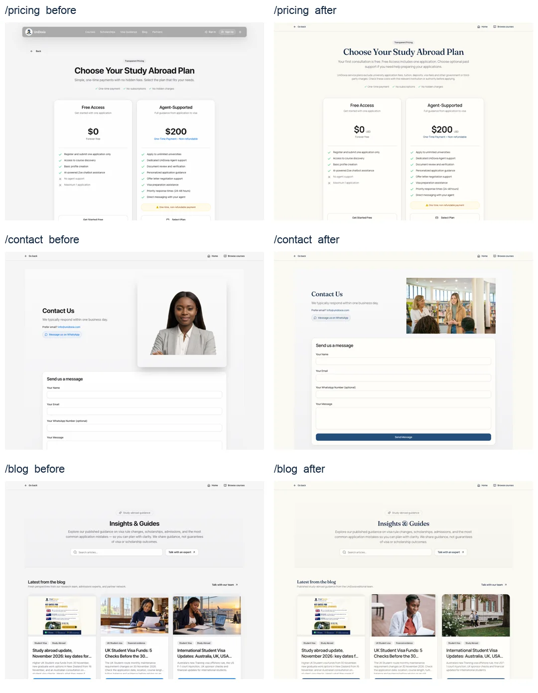

# UniDoxia homepage and public-journey owner review

7 November 2026. Branch `redesign/public-homepage`, [PR #1288](https://github.com/Otsikow/unidoxia/pull/1288). Baseline commit: `b4a546de97272480de1977d0dd5f6ca006bc8018`. Local preview: http://127.0.0.1:4192/. This report supersedes earlier audits for this pass. No production publication, database write, permission change, payment or new live form submission was made.

## Changes and verified outcomes

| Area | Confirmed problem and correction |
| --- | --- |
| Homepage layout | Preserved the approved hero, authentic well-dressed students, six destinations, four steps, UK/international listings, partner invitations, seven social destinations, compact WhatsApp, optional Zoe and footer. At tablet width, the training action now sits below its copy, avoiding the cramped desktop column and floating contact control. Desktop reference styling and original wording remain. |
| Public-page identity | Discovery, article, pricing, contact and other public pages now share the homepage's Manrope/Fraunces typography and restrained light palette. Dark preferences remain supported. Existing page structure and functional controls are retained. |
| Authentic photography | Replaced the unverified Contact portrait with the already credited Pexels education-guidance photograph. The two unverified portrait-style article thumbnails now use Charlotte May's student photograph and Armin Rimoldi's campus photograph. Their responsive assets are shared across homepage, blog cards and article presentation, including structured-data images. Article records and text are unchanged. The November article's published graphic remains. |
| Pricing and fees | The pricing route inherited the homepage title/canonical and used a different floating navigation treatment. Added its own metadata, canonical and meaningful initial HTML; aligned it with the common public navigation and removed duplicate Back controls. Explicitly identifies USD beside both prices. States the free initial consultation, one-application Free Access plan and optional paid support; excludes university application fees, tuition, deposits, visa/government and third-party charges. Existing client and checkout configuration both specify USD 200 for Agent-Supported support. No price, billing entitlement, checkout or refund rule was changed. |
| Unsupported marketing | Removed the unsupported “500+ universities” pricing claim and broad scholarship/deadline assurances. The agent welcome/earnings pages also contained hard-coded 10–18% commission tiers, bonuses and guaranteed Friday payouts. Replaced those public promises with instructions to confirm rates, eligibility, currency and timing in writing. Account/signup actions and commission workflows are unchanged. |
| Accessibility | Named and enlarged the login password-visibility control, exposed its state and added current-password autocomplete. Added meaningful login/signup/feedback/visa page headings. Labelled visa selectors, feedback rating buttons and agent onboarding progress. Improved blog tab and article-action contrast and labelled article search. Clear remains functional with a neutral, readable button treatment. |
| Performance | Split homepage Radix primitives from form/dialog code used on later routes. Measured startup JavaScript transfer fell by roughly 16 KB. Full loading performance remains variable and below target; all measured results are reported below. |
| Verification reliability | Corrected three invalid `exact` options in existing Testing Library document tests. Default unit-test workers are bounded to two after large staff/admin fixtures timed out under unbounded concurrency. Assertions, application logic and time limits were not weakened. |

## Visual evidence

[Full desktop before/after](homepage-review/owner-home-desktop.webp) · [Full mobile before/after](homepage-review/owner-home-mobile.webp)

Fresh full-page homepage PNGs cover **390, 768 and 1440px**, with saved-dark captures at 390/1440px. Every section was inspected. All **15** homepage content images, including the restored training logo, decoded. No horizontal overflow, page errors or rendered em dashes were found. All 15 footer navigation icons remain; mobile link targets meet the checked 44px height. Fresh contexts defaulted to light even with a dark operating-system preference, and explicit dark choices survived reloads. No service worker or Cache Storage entries were present.

The link audit clicked **38 distinct internal homepage destinations at both 390 and 1440px**, producing **76 rendered destination checks and full-page captures**. Before corrections, 16 of those views had one or more sampled axe violations. After corrections, all 76 had zero sampled axe A/AA violations, zero overflow, zero page errors and no failed visible images. Duplicate homepage links were grouped by destination; all configured hrefs were inventoried. Hidden mobile images were excluded from visible-image failure counts. Automated checks do not establish full accessibility conformance.

Full-resolution captures, before/after route inventories, Lighthouse JSON, image/loading inventories, country checks and raw logs are retained in the workspace `outputs/unidoxia-owner-review/` directory. Homepage PNGs are `before/home-{width}.png` and `after/local-{width}.png`.

## Functional checks

- **114 desktop/mobile browser checks passed**, covering search, combined filters, loading/error/empty/retry states, no-JavaScript search, published articles, university profiles, registration handoffs and verification states, consultation/intake forms, contact failure/retry/duplicate protection, partner entry routes, social-link configuration, WhatsApp opening, Zoe's anonymous prompt, keyboard controls and theme persistence. New feedback tests exercise a failed draft and successful retry entirely through intercepted responses.
- The final agent-copy refinement was followed by **16 passing focused public/partnership checks**, including the new earnings-terms assertions. The signup journey remains intact.
- **622 unit tests across 96 files passed** using the standard `npm test` command with bounded workers. Earlier unbounded attempts timed out in two large staff/admin tests and then one; those runs are retained as evidence. The final standard run passed in 25.83 seconds without relaxing assertions or timeouts.
- Application type checking and changed-file lint passed. The three previously reported test type errors are corrected.
- Production build, sitemap, canonical/metadata/H1 and local hosting-adapter checks passed for **1,537 public URLs**, including the new pricing HTML. The adapter was not deployed. Private routes retain their indexing restrictions.
- Live public UI searches returned results for all six main destinations. The UI displayed UK 1,229 courses across six universities, Canada 177 across six, and 15 across three for each of USA, Australia, Ireland and Germany. These are the displayed search counts at review time, not a guarantee of current intake or applicant eligibility. Spain, Malta and UAE correctly explained that listings were unavailable and linked to adviser help. New Zealand remains an enquiry choice, not a claimed searchable catalogue.
- All four homepage FAQs opened and closed by keyboard. Existing menu, escape/focus and form keyboard checks passed.
- Seven restored social URLs and safe new-tab behaviour are retained. Fresh automated attempts to fetch the provider pages were blocked or unavailable through the web tool; current authenticated provider identities were not independently re-established in this pass. Earlier normal-browser identity evidence remains in the preceding audit. WhatsApp opened the configured contact; no message was sent.

## Training and photography sources

The individual certificate, badge and PDFs remain visible through About and Eric Arthur's personal page. The [British Council training guidance](https://www.britishcouncil.org/education/education-agents/training-agents) confirms that the award applies to an individual and does not establish organisation accreditation. The exact homepage strip was preserved at Eric's explicit direction. Separate authorisation for the standalone British Council organisation logo has **not** been established. The individual certificate does not supply that evidence; a permission letter or official reference is still needed before branding can be described as fully verified. The existing paragraph's broader adviser wording also goes beyond the single individual credential that has been checked.

The [Pexels licence](https://www.pexels.com/license/), [Charlotte May source](https://www.pexels.com/photo/serious-black-woman-with-notebook-5965546/) and [asset credits](../public/home/ASSET-CREDITS.md) document the replacement photography and existing hero/journey/campus sources. Images illustrate education and do not represent named UniDoxia applicants, employees, results or institutional partnerships. No generated human photograph was introduced. This is not a licence audit of every older image embedded in the full article archive.

## Performance and release limits

| Independent local Lighthouse run | Performance | Accessibility | Best practices | SEO | LCP | TBT | CLS |
| --- | --- | --- | --- | --- | --- | --- | --- |
| Before, mobile | 83 | 100 | 100 | 100 | 4.06s | 232ms | 0 |
| First bundle comparison, mobile | 85 | 100 | 100 | 100 | 3.92s | 193ms | 0 |
| Final visual build, desktop | 99 | 100 | 100 | 100 | 0.83s | 13ms | 0 |
| Final visual build, mobile | 77 | 100 | 100 | 100 | 4.07s | 420ms | 0 |

Audits ran separately from the browser/unit suites, with analytics writes blocked. The smaller bundle is verified, but these measurements do **not** demonstrate a consistent speed improvement. Mobile startup/main-thread work and the static-to-React handoff remain unresolved performance limitations. Local lab scores are not field Core Web Vitals. The final copy-only agent changes do not alter the homepage layout, photography or loaded library set measured here.

Authenticated final applications, uploads, partner submissions, payment completion, actual consultation/feedback persistence and authenticated Zoe answers were not tested against live accounts. Form responses were intercepted to honour the no-production-data requirement. The earlier single approved contact test returned success from the live endpoint, but recipient inbox delivery remains unverified; this pass did not send another test.

The visual and public-interaction refinements are ready for owner review. Mobile performance, standalone-logo authorisation and live authenticated acceptance remain open release gates. No production deployment is authorised by this report.
