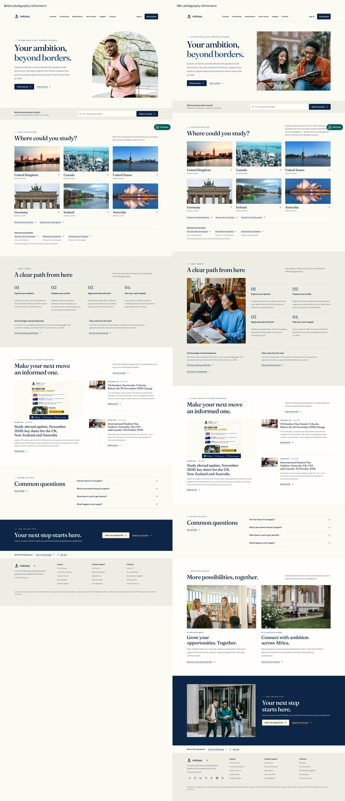

# UniDoxia photography and partnership review — 7 November 2026

Draft design work on `redesign/public-homepage`, [PR #1288](https://github.com/Otsikow/unidoxia/pull/1288). The built preview runs at http://127.0.0.1:4192/ on Eric’s Mac. No merge, production deployment, account creation, message or database write was performed. The preview is local, not hosted staging.

## Visual refinement

- Replaced the previous hero with an original licensed campus photograph of two neatly dressed students in jackets reviewing notes. This incorporates Eric’s latest correction about clothing. Faces, clothing and backgrounds remain photographic originals. The short-top photograph explored during this pass was removed.
- Retained the editorial type system, headline, student-first course discovery and equal six-country destination layout. The destination introduction now describes the wider regions and links to the live catalogue through “Explore more destinations”, without promising unverified recruitment agreements or course availability.
- Paired a natural library study photograph with the four numbered application steps. The steps remain semantic text, rather than being embedded in an image or decorative cards.
- Added a coherent two-column partnership section near the bottom, with an adult education discussion and a campus scene. One invitation leads to existing agent onboarding, the other to the university recruitment enquiry page. Copy describes a potential collaboration and contains no commission or outcome promises.
- Added a campus photograph to the closing student application invitation. It remains a solid navy split composition with legible text, rather than text over a busy photograph.
- Retained the real published blog feed and covers. Added responsive small-cover derivatives so compact supporting thumbnails do not fetch the full-size homepage cover. Future article covers without derivatives retain their actual stored image URL.
- Added smaller destination images and responsive AVIF/WebP student photographs. The hero is prioritised and preloaded; all new lower-page photographs are lazy-loaded. WhatsApp now matches the original compact circular appearance: 36px on mobile, 40px on desktop, with a 20px logo. Its invisible 44 × 44 px hit area and accessible label are retained at both sizes.

All five selected photographs are used under the [Pexels licence](https://www.pexels.com/license/). They illustrate education and do not depict UniDoxia staff, customers, successful applicants or contracted partner institutions. [Asset provenance](../public/home/ASSET-CREDITS.md) identifies the sources and derivative files. No ApplyBoard photographs, generated faces or university trademarks were added.

[Full mobile before-and-after comparison](homepage-review/photography-mobile.webp)

## Social links

Restored the seven URLs already in `src/components/layout/AppFooter.tsx`: Facebook, Instagram, LinkedIn, X, TikTok, Reddit and the WhatsApp channel. Links have recognisable icons, accessible names, 44px targets and safe new-tab attributes. There was no verified YouTube URL in the existing project or public search, so none was invented.

Each link was actually opened from the homepage. Facebook resolved to “UniDoxia | Redcar | Facebook”, Instagram to the configured `@unidoxia` profile, and TikTok displayed `unidoxia.com1` with UniDoxia’s study-abroad description. LinkedIn returned Cloudflare protection, X returned HTTP 403, and Reddit returned a network security block. The WhatsApp channel URL resolved but supplied no readable profile identity in the automated browser. Those limitations remain; URL correctness against the existing business configuration is not represented as full independent profile verification.

## Individual British Council badge

Located Eric’s `Badge.pdf`, `BCACTSBadgeGuidelines2026.pdf` and certificate in the Mac’s UniDoxia `Certs` folder. The original badge JPEG was extracted unchanged from the awarded PDF, retaining its full colour artwork and 500 × 500 dimensions. Its SHA-256 is `faad6fc6846a1847e02e9da3560ce709564b72e29b152f3c6f1826c7931a2932`, matching the extracted source.

The supplied guidelines expressly prohibit badge use on “Main pages on a website that are not about you personally” (page 3). They permit individual use exclusively connected to the recipient’s name, require unaltered artwork, secondary positioning, clear space and at least 150px width. The badge therefore appears on Eric’s personal `/about/eric-arthur` page, linked from the homepage credentials section. It is not displayed as an organisation badge on the homepage. The isolated British Council logo was also removed from the general About page and replaced with a link to Eric’s credentials.

The personal page uses the exact official descriptor, links the original award and certificate PDFs and distinguishes their dates. Certificate 114757 is valid until 16 July 2028; the badge award says 18 July 2026 to 17 July 2028. It explicitly says the British Council does not endorse, accredit or validate UniDoxia or its services. The [British Council’s public training page](https://www.britishcouncil.org/education/education-agents/training-agents) also explains that the award belongs to an individual.

## Verification and boundaries

The full unit suite, desktop/mobile acceptance suite, build/SEO checks, viewport/image checks and targeted lint were run. Final measurements are recorded below.

| Check | Outcome |
| --- | --- |
| Full unit suite | 619 passed across 95 files |
| Full desktop/mobile acceptance suite | 68 passed |
| Affected browser checks after responsive-image optimisation | 24 passed |
| Build, sitemap and hosting adapter | Passed; 1,536 public URLs including the new personal credentials page |
| Changed-file lint | No errors; one pre-existing App.tsx fast-refresh warning |
| TypeScript application check | Same three pre-existing errors in unchanged Documents.test.tsx, lines 43, 48 and 75; no new errors |
| Visual/image/overflow checks | Passed at 320, 375, 390, 430, 768, 1024, 1440 and 1920 px |
| axe WCAG A/AA scans | No reported violations in light mode at 320/1440 and saved dark at 390 px |
| Personal badge page | Captured and inspected at 390/1440 px, no overflow; original 500px badge displayed at least 150px wide |
| Lighthouse desktop | Performance 100, accessibility 100, best practices 100, SEO 100; LCP 0.7 s, CLS 0 |
| Lighthouse mobile | Performance 85, accessibility 100, best practices 100, SEO 100; LCP 4.1 s, TBT 180 ms, CLS 0 |

The final mobile audit fetched a 34KB hero AVIF and 11KB supporting blog thumbnails. A diagnostic run overlapping an accessibility scan scored 69 with 720ms TBT; its report is retained as `lighthouse-mobile-concurrent.json`. The final mobile audit was repeated separately. Mobile performance remains below 90 and LCP remains above 2.5 seconds, despite appropriately sized photographs. Existing application startup and the static-to-React handoff remain performance limits. These local lab results are not field Core Web Vitals or evidence of increased conversion.

The browser suite tested the actual agent invitation through onboarding and earnings to agent registration, and the university invitation through its enquiry explanation and account requirement to partner registration. The current university enquiry is account-gated; no authenticated enquiry was submitted. Student signup, consultation and contact success/error paths used intercepted responses, so no real accounts, leads, email or admission transactions were created.

The code does not modify auth policies, privileged role handling, database permissions, student application operations, agent commission logic or university administration. Existing anonymous protected-route redirects were checked. Authenticated portal operations, message delivery and Zoe’s authenticated answers remain outside the verified scope.

The full-page before/after images for desktop, tablet and mobile, eight final viewport captures, personal-credential screenshots, verification logs and Lighthouse JSON reports are in the local workspace `outputs/unidoxia-photography/` directory. Production release remains approval-gated. The existing Lovable main-branch preview must not be represented as this unmerged branch.

## Compact WhatsApp follow-up

Matched the original launcher’s visible sizes and green circular treatment across mobile and desktop. Removed the visible desktop text pill. The existing contact URL, analytics and new-tab behaviour are unchanged. The production build/SEO checks and focused desktop/mobile WhatsApp interaction checks passed. Browser measurements confirm 36/40px visible circles, a 20px logo and a 44px hit target. No production deployment.
