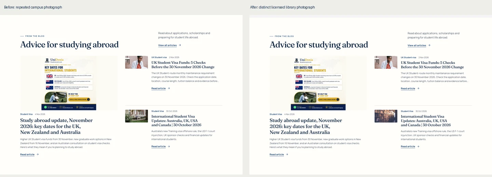

# Homepage readiness review

7 November 2026. Review branch: `codex/homepage-final-readiness`, based on `df65d99b8a7726ce6d8049e1f0f6aaed371f0847`.

**Publication is on hold at Eric's instruction.** PR #1288 was already merged into GitHub main before that instruction. Its code was seen in the connected Lovable preview, but the production Publish action was not completed. This follow-up branch is separate and must remain unmerged until reviewed. No production database, account, permission, billing or deployment changes were made in this pass.

The working preview is <http://127.0.0.1:4192/>. Its original process, PID 87273, still serves this repository's `dist` directory. The [build record](http://127.0.0.1:4192/build-info.json) identifies the running branch, commit, dirty state, build time and HTML hash. Capture scripts check the served HTML against that hash. A localhost address works on this Mac, not as a public online preview.

## Changes in this follow-up

The homepage already has the approved hero, destination photography, four-step application journey, fee explanation, published insights, partner invitations, social links and compact contact controls. Those improvements were preserved.

The blog was reusing the university-partnership photograph. Replaced that known thumbnail with Janko Ferlic's authentic library photograph, [Pexels 590493](https://www.pexels.com/photo/light-inside-library-590493/), under the [Pexels licence](https://www.pexels.com/license/). The source was visually inspected. Responsive 320/640/1100px WebP files are approximately 9/21/42 KB. The replacement is shared by homepage cards, blog listings, article presentation and structured-data cover handling. Published article records and text are unchanged. [Asset credits](../public/home/ASSET-CREDITS.md) record provenance.

A CSS `content-visibility` experiment reduced some startup work but left blank offscreen sections in full-page screenshots. It was rejected and removed. The final screenshots and final browser suite use the reliable original rendering behaviour. No claimed speed improvement relies on that rejected experiment.

## Screenshots and visual inspection

[Desktop before/after](homepage-review/readiness-1440.webp) | [Mobile before/after](homepage-review/readiness-390.webp)

Before means the completed PR #1288 homepage, rather than an artificially weakened starting point. Fresh full-page PNGs at **390, 768 and 1440px** are retained in the workspace `outputs/unidoxia-readiness-qa/after/local-{width}.png`. Saved-dark captures cover 390/1440px. Every section was visually inspected, including hero crop, training strip, six destination images, university listings, four steps, fee copy, three real articles, FAQs, both partnerships, final application action, contact controls and footer. No additional visual regression was found after rejecting the rendering experiment.

All **15 content images** decoded at each width. There was no horizontal overflow, page error or rendered em dash. All 15 footer navigation icons remain. Checked mobile footer navigation targets are at least 44px high. Fresh visitors get light mode even with a dark system setting; explicit dark preferences survive reloads. There were no service-worker or Cache Storage entries serving stale content.

## Functional verification

| Area | Observed result and boundary |
| --- | --- |
| Automated browser suite | **114 passed** across desktop/mobile, including public navigation, course-search parameters, combined/removable filters, invalid/loading/error/empty/retry states, no-JavaScript discovery, registration validation and verification handoff, article navigation, contact errors/retry/duplicate protection, consultation, partner entry routes, WhatsApp, Zoe entry, keyboard controls and saved themes. Mutating backend requests were intercepted. |
| Unit tests | **622 passed across 96 files** with the standard `npm test` command. Application type checking, changed-file lint and diff whitespace checks passed. |
| Build and SEO | Production build passed. Generated and verified **1,537 public URLs** for initial HTML, canonical, metadata, one H1 and business footer. Private/unknown route indexing and optional hosting-adapter checks passed locally. The adapter was not deployed. |
| Live read-only course searches | All six main countries returned results: UK 1,229 courses/6 universities; Canada 177/6; USA, Australia, Ireland and Germany each 15/3. Spain, Malta and UAE displayed the explicit unavailable-listings message and `/free-consultation` adviser link. Counts are UI observations, not verified current intake availability or an eligibility promise. |
| University geography | Three existing featured UK placements and five existing international directory links remain. International links cover Canada, USA, Germany, Ireland and Australia. Listings are not presented as recruitment partnerships. No new institution or programme was invented. |
| Contact delivery | Earlier in this same review sequence, the single authorised internal test, reference `UDX-HOME-QA-20261107`, received HTTP 200 and `{success:true}` at 10:25:22 UTC, with success feedback and cleared fields. The handler awaits its email-provider requests. **Recipient inbox delivery has not been verified.** No second live test was sent in this follow-up. |
| Partnerships and applications | Agent/university invitations reached their existing onboarding and registration journeys. Selected-course application handoffs and simulated student signup passed. Authenticated final submissions, document uploads, offers, account permissions and payment completion were not exercised against live student data. |
| Social and assistance | Seven restored social URLs and safe new-tab attributes remain. WhatsApp opened the configured destination without sending a message. Zoe's optional anonymous entry was checked; a signed-in AI conversation was not verified. Current provider account identities were not re-established through authenticated social sessions. |
| Accessibility | Fresh homepage axe WCAG A/AA samples at all three widths and saved-dark samples had zero violations. Four FAQs opened and closed by keyboard. This is evidence from the tested states, not a claim of complete accessibility conformance. The preceding review also checked 38 distinct internal destinations at two widths, with 76 clean rendered route audits. |

## Credentials and content accuracy

Eric Arthur's original individual badge and certificate remain accessible through About and his personal profile. The certificate and badge have their separate recorded award/expiry dates. The badge is not placed on the company homepage. The current [British Council training page](https://www.britishcouncil.org/education/education-agents/training-agents) states that the award applies to an individual and does not confer organisational endorsement or accreditation. Its [terms of use](https://www.britishcouncil.org/terms) also restrict unauthorised commercial reuse of its content and logo.

**Open owner decision:** the exact homepage strip and logo were preserved as expressly requested. A separate permission letter for that standalone organisation logo has not been found. The paragraph's plural adviser claim also exceeds the single individual award checked. Do not describe this branding as authorised or UniDoxia as accredited on the evidence currently available. Recommendation: obtain applicable written permission and substantiate the broader wording, or approve an individual-only text treatment linking to Eric's verified award before publication.

Pricing remains consistent with the existing client/checkout configuration: free initial consultation, one-application Free Access and optional Agent-Supported support at **USD 200**. University application charges, tuition, deposits, visa/government and third-party costs are separate. No fee or checkout entitlement changed.

The three displayed articles were opened. Their main dated financial/policy claims were cross-checked against primary sources on 7 November: [Home Office HC 584](https://www.gov.uk/government/publications/statement-of-changes-to-the-immigration-rules-hc-584-3-september-2026/statement-of-changes-to-the-immigration-rules-hc-584-3-september-2026-accessible), [INZ graduate diploma announcement](https://www.immigration.govt.nz/about-us/news-centre/post-study-work-visa-eligibility-extended-from-16-november-2026/), [INZ short-term graduate visa](https://www.immigration.govt.nz/visas/short-term-graduate-work-visa/), [Australian consultation](https://www.homeaffairs.gov.au/help-and-support/how-to-engage-us/consultations/consultation-on-proposed-reforms-to-the-genuine-student-requirement-and-financial-capacity-framework), [Australian Training visa regulations](https://www.legislation.gov.au/F2026L01449/asmade/2026-10-30/text/original/epub/OEBPS/document_1/document_1.html), [US OPT proposal](https://www.govinfo.gov/content/pkg/FR-2026-10-08/html/2026-20660.htm), [IRCC financial support](https://www.canada.ca/en/immigration-refugees-citizenship/services/study-canada/study-permit/get-documents/financial-support.html) and [IRCC Haiti/Sudan notice](https://www.canada.ca/en/immigration-refugees-citizenship/news/notices/canada-temporary-measures-people-affected-crises-haiti-sudan.html). The litigation party's [current case page](https://www.presidentsalliance.org/duration-of-status-litigation/) still reports the US duration-of-status rule blocked; the underlying live court docket was not independently reviewed. The articles distinguish scheduled changes, consultations, proposals and current requirements. Existing editorial safeguards remain for three older articles. This was not an exhaustive immigration-law or full catalogue audit.

## Security scan scope

The connected Lovable quick scan displayed broad-read findings for `intakes`, `catalogue_sources` and `university_search_aliases`, plus public listing/read findings for university media and blog images. Repository definitions identify programme intakes, catalogue provenance/search aliases and public marketing assets. The university-media migration separately restricts uploads/changes/deletions by partner role and tenant or staff/admin authority. These findings do not by themselves demonstrate access to student documents or write privileges. Live policy SQL was not independently queried, so this is not a blanket security clearance. No policies or permissions were changed and no automatic fix was applied.

## Performance and readiness

Final independent Lighthouse measurements are recorded below. All raw JSON, test logs, rejected-experiment evidence and full-resolution screenshots remain in `outputs/unidoxia-readiness-qa/`.

| Profile | Performance | LCP | Total blocking time | Layout shift |
| --- | --- | --- | --- | --- |
| Mobile, run 1 | 83 | 3.88s | 254ms | 0 |
| Mobile, run 2 | 82 | 4.29s | 65ms | 0 |
| Desktop | 99 | 0.79s | 0ms | 0 |

Accessibility, best-practice and SEO scores were 100 in all three final samples. Mobile LCP remains above the 2.5s good threshold. These local simulated measurements are not field Core Web Vitals and show no consistent improvement attributable to this small photography change. The earlier reviewed build also varied (mobile 77 to 85). The rejected offscreen-rendering experiment is excluded from the final results.

**Recommendation:** ready for owner review, with publication held. Resolve the British Council branding/wording question and review the documented mobile performance and live end-to-end limitations before production approval. The local visual/functional checks passed; they do not prove live email receipt, authenticated application completion or current course eligibility.
