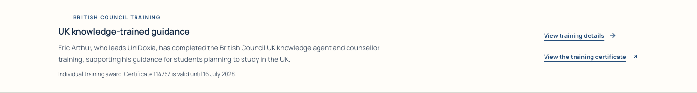

# British Council training information follow-up

7 November 2026. Eric requested the information to be presented like the existing production homepage. The actual production page was inspected and captured read-only.

Restored its dedicated strip immediately after course search, the heading “UK knowledge-trained guidance” and the “View training details” action. The strip uses the redesigned site's typography and colours, with a restrained horizontal desktop layout and stacked mobile layout. The certificate remains directly accessible. The duplicate training text was removed from the application-journey section; service-fee guidance remains there.

Wording identifies Eric Arthur as the trained individual, retains certificate 114757 and its 16 July 2028 validity date, and links to his personal badge page. It does not assert company accreditation or that every adviser has completed this training. The old standalone British Council logo was not copied: no separate authorisation for corporate logo use has been established. The awarded personal badge remains unaltered on Eric's personal profile.

The [British Council's official training page](https://www.britishcouncil.org/education/education-agents/training-agents) explicitly distinguishes the individual award from organisation accreditation. This was rechecked during this change.

Eight existing desktop/mobile browser checks passed, including the updated training-details link, personal badge and PDF, partner routes and social links. Changed-file lint and the production build passed, including 1,536 public SEO pages. Fresh full-page 390/768/1440px screenshots were captured; all three layouts fit their viewport, defaulted to light, and had no page errors or sampled axe A/AA violations. The strip and both links are present without JavaScript. Mobile dark appearance was also captured. No new form submission, backend write, main merge or production deployment was made.

Full-page PNGs, the production baseline and raw check logs remain in the workspace outputs directories. Changes continue in PR #1288 on `redesign/public-homepage`.
