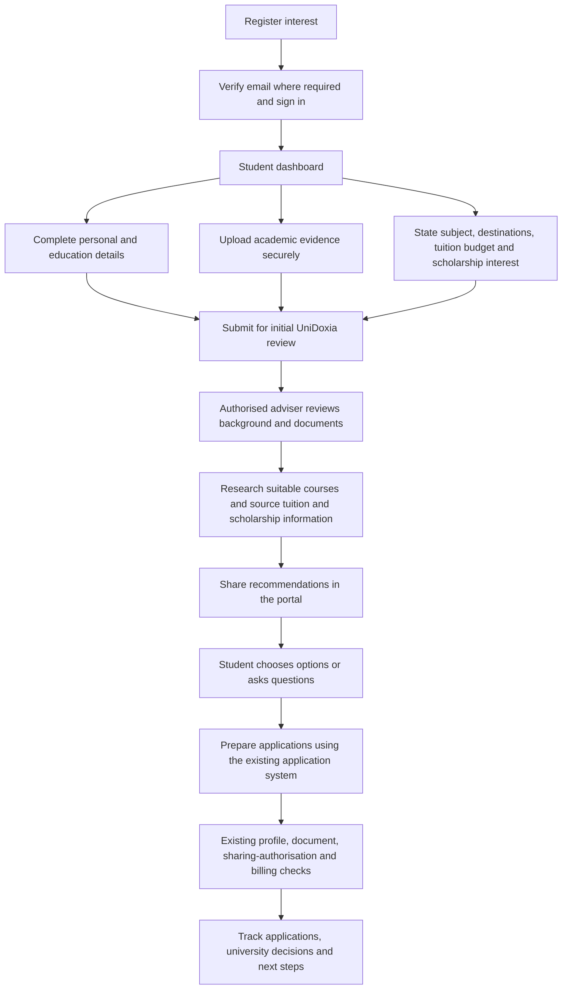
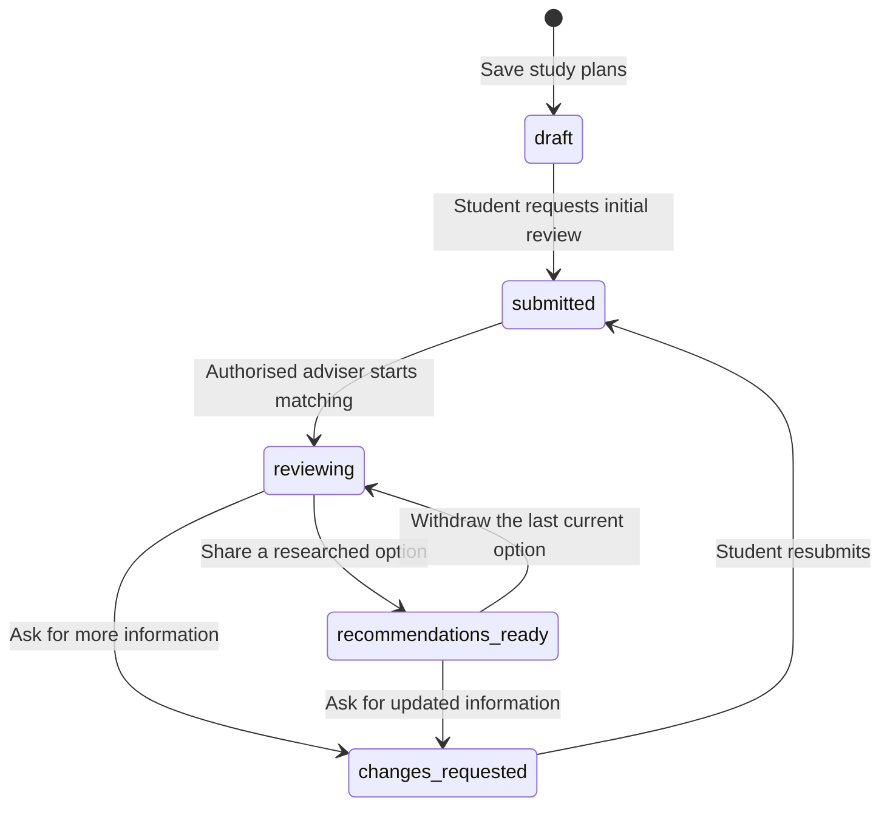

# Registration-first recruitment and adviser placement

7 November 2026. Review branch: `codex/registration-led-recruitment`, based on `33d0060` (the preserved final photography/QA branch). Publication remains on hold. This implementation includes the earlier QA work without removing the course finder, directories, partner journeys, social links, WhatsApp or Zoe.

## Student journey

The homepage's main action is **Register Your Interest**. The hero, first conversion section and closing action lead to student registration with an explicit `/student/dashboard` return destination. The large homepage search form is replaced by four clear preparation steps. Six stages explain that UniDoxia reviews the student's background, researches options and supports the student's chosen applications. Destination listings and university directories remain optional research resources. Hero/destination/partner photography and the published insights feed are retained.

Both `/dashboard` for the student role and `/student/dashboard` now reach the same progress-led dashboard. `/student/profile`, private uploads, messaging, applications and payment pages remain their existing workflows. Existing email verification and signup fields are preserved.

The eight dashboard milestones use saved data: registered account, personal profile, education history, uploaded academic evidence, submitted review, matching progress, shared recommendations and existing application/admissions progress. No demo course list or automatic success state is substituted for adviser research.

An **initial matching review** needs the student's name, email, nationality, education history and an uploaded transcript or qualification certificate that has not been rejected, plus the study plan. It does not require every university-specific profile field or an SOP before an adviser can consider options. The complete existing application gates still apply before university submission. A stored document reference does not establish authenticity or admission readiness; staff must review the actual files.

## Staff and administrator workflow

Administrators have a placement queue on Students and a University matching tab in the existing student detail page. Staff have a dedicated `/dashboard/placement` workspace using the same student detail component, including its Education, Documents and Applications tabs. This provides the authorised-staff path without widening the administrator-only shell. New staff access is checked against trusted `user_roles`, an active profile and the student's tenant. Agents and university partners have no access to the new placement records.

The queue separates pending reviews from shared recommendations, with pagination. A reviewer can request more information or start matching, search real active catalogue courses, explain the academic/budget rationale, record sourced tuition and potential scholarship conditions, and share an option. Unknown tuition remains explicitly unknown. A tuition amount or scholarship claim requires an HTTPS source and check date; future check dates and zero-price stand-ins are rejected. The server obtains course/university names from existing catalogue records.

Students can record interest, ask a question or explain why an option is unsuitable. Staff see the saved preference and can open the existing application form with the chosen student and course. That action does not bypass consent, document or payment checks. Choosing a recommendation does not itself submit an application, accept an offer or make a payment.

Resubmitting revised plans withdraws older recommendations so that stale choices are not presented as current. Withdrawn records retain their history. Version checks prevent stale changes overwriting newer work. Recommendation request IDs and a unique active-course constraint protect retries. Deleting a course or staff account retains the recommendation snapshot without blocking the existing deletion workflow.

## Data and activation

The additive migration is `supabase/migrations/20261107124135_adviser_led_student_placement.sql`. It adds two tables and guarded RPCs for study plans, review and student responses. Existing student identities, qualifications, documents, application records, status enums, role assignments, billing entitlements and private buckets are reused. No production data, migration, permission or deployment was changed during implementation.

The new tables enable row-level security. Authenticated clients have SELECT only, restricted to their own records or authorised same-tenant staff. Students cannot set review statuses, change recommendation fees, publish recommendations or access another student's plans. Writes use narrowly guarded RPCs with fixed search paths; privileged checks never use signup `user_metadata`. Source and input checks apply on the server as well as in the forms. The frontend uses the existing Supabase client, with a typed overlay for the unapplied schema, not another Auth client.

**Do not publish the new frontend before activating and checking the backend.** Until the migration exists, the new dashboard explicitly reports that adviser review is unavailable and retains links to the existing profile, document and contact pages. It never fabricates a review or hides the failure behind an empty success state.

Before an approved release:

1. Review this PR and migration, including the trusted-role/tenant boundaries.
2. Apply the exact migration transactionally through the managed UniDoxia release process and record its migration version. Obtain explicit approval for production database activation; a GitHub merge is a separate action.
3. Regenerate the main Supabase types and replace the temporary typed overlay after activation. No new credentials, email provider, payment provider or environment variables are needed.
4. Check the deployed RPC schema, authenticated row visibility, private uploads, staff review and student responses using authorised disposable accounts. The prepared isolated acceptance suite verifies the candidate without hosted credentials; it does not certify existing live policies.
5. Publish the frontend only after approval and verify the actual public and authenticated journeys.

Rollback the frontend if necessary while retaining placement data. Do not drop these tables or discard student preferences without a separate, reviewed data decision.

## Preserved trust and fees

The training strip now accurately names Eric Arthur's individual British Council training and links directly to his award. It does not claim organisational accreditation or endorsement. The previously requested standalone logo is retained; separate permission for that asset remains unverified, as recorded in the preceding owner review.

Registration and the initial consultation are described as free. Optional paid services and university/government/third-party charges remain separate. Existing plan prices, entitlements and checkout code are unchanged. Scholarship notes are research information with conditions, rather than awards or guaranteed eligibility.

## Verification and limitations

The initial local run passed 627 unit tests across 97 files. Type checking and changed-file lint passed before the final evidence run. The PostgreSQL harness passed 36 ownership, role, tenant, validation and state checks. The isolated browser test follows the actual student and staff components against the candidate SQL and real PostgreSQL RLS, including failed-save preservation, submission, source-backed sharing, feedback and reload persistence. Its Auth identities are synthetic fixtures; it makes no live account or email changes.

The broader browser run initially passed 112 checks, with four failures in tests still expecting removed homepage fields or checking an asynchronous search URL before completion. Updated those checks for registration-first behaviour; all four focused reruns passed. The final full-run results, actual Auth/Storage acceptance and screenshots are recorded in the accompanying review report when complete.

Existing profile editing now checks read errors before calculating completeness. A failed document-status lookup shows a retry action instead of falsely declaring all documents present. Upload integrity, staff document review, sharing authorisation and billing implementations are unchanged.

The GitHub backend acceptance option `placement` creates a disposable localhost Supabase stack. It exercises real Auth/signup/password sessions, Data API RPCs/RLS and private Storage with synthetic files. Email confirmation is performed administratively for those synthetic users; external inbox delivery and a student's manual email-link click are not established. Its minimal representative private Storage fixture is not a copy or certification of every production policy. Fixtures and stack must be removed and independently checked; no production keys, provider keys, artefact upload or deployment are allowed.
